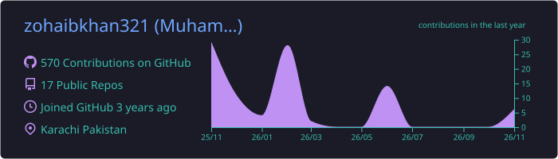
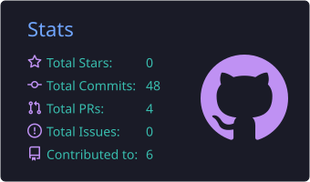
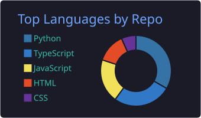
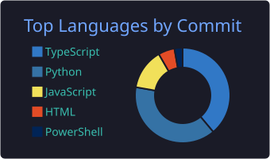
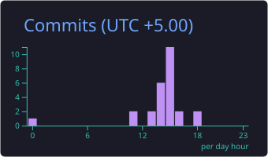

<!-- ==================== HEADER ==================== -->

<h1 align="center">Muhammad Zohaib Imtiaz</h1>

  

  Scalable web and digital product development · React · Next.js · Angular · Node.js

  
  
  
  

---

## 👋 About Me

I'm a **Software Engineer** based in Karachi, Pakistan, building scalable web applications and high-quality digital products across healthcare, HR and enterprise software, booking platforms, e-commerce, fintech, and real estate.

Frontend engineering is my strongest area, and I back it with hands-on full-stack work: REST APIs with Node.js and Express, and databases such as SQL Server, MySQL, and MongoDB. AI is part of my daily workflow, and I'm currently deepening it into **agentic AI systems** through coursework at Governor House Sindh and hackathons.

- 💼 **Working at:** Decibel HRMS, as Specialist Software Engineer (Angular, TypeScript, RxJS)
- 🎯 **Focus:** scalable frontend architecture, reusable component systems, performance, API integration
- 🌱 **Exploring:** agentic AI systems, advanced system design
- 💬 **Ask me about:** React, Next.js, Angular, Node.js, and AI-assisted development workflows
- 🌐 **Portfolio and case studies:** [muhammadzohaibimtiaz.pages.dev](https://muhammadzohaibimtiaz.pages.dev/)

---

## 🧠 Tech Stack

### 💻 Languages

### ⚛️ Frontend Frameworks and Libraries

### 🎨 UI and Styling

### 🔄 State Management

### 🌐 Backend and Databases

**API and integration:** REST APIs · Axios / Fetch · Authentication flows · JWT-based systems · Role-based dashboards

### 🚀 Performance and Optimization
Code splitting · Lazy loading · Image optimization · SEO optimization (Next.js) · Lighthouse improvements

### 🛠️ Tools and Workflow

---

## 🤖 AI-Enhanced Engineering

I treat AI as part of the engineering toolchain, not a shortcut around it. I work **spec-first**: requirements and acceptance criteria are written before code, AI tools build against that spec, and I review every change before it ships. I've built repeatable workflows around this that cover the development cycle from the first spec to the final review.

| Specify | Plan | Build | Verify | Review |
| :---: | :---: | :---: | :---: | :---: |
| Requirements and acceptance criteria first | Tasks, architecture options, edge cases | Agent-assisted, in small reviewable steps | Debugging, tests, acceptance checks | Every change read and refactored by me |

### AI tools and platforms

**Method:** spec-driven development · agent-assisted implementation · AI-assisted debugging and testing

---

## 💼 Experience

| Period | Role | Company |
| :--- | :--- | :--- |
| May 2026 – Present | **Specialist Software Engineer** | Decibel HRMS · Karachi |
| Apr 2025 – May 2026 | **Manager, Frontend Engineering** | Meri Sehat · Karachi |
| May 2023 – Apr 2025 | **Frontend Developer** | Futech Solutions · Karachi |
| Mar 2024 – Nov 2024 | **Software Engineer, Frontend** | SaaS Innovations · Poland (remote) |
| Dec 2023 – Feb 2024 | **Frontend Developer** | Finnovatortech · Saudi Arabia |

Full details and project case studies are on my [portfolio](https://muhammadzohaibimtiaz.pages.dev/#experience).

---

## 📦 Featured Work

| | Project | What it is | Link |
| :---: | :--- | :--- | :--- |
| 🩺 | **MeriSehat** | AI-enabled digital health platform connecting patients with doctors | [merisehat.pk](https://merisehat.pk/) |
| 🚗 | **Hobbs Transfers** | UK airport transfer, city ride, and chauffeur booking platform | [hobbstransfers.com](https://hobbstransfers.com/) |
| 🏥 | **Elderly Care ERP** | Enterprise healthcare equipment management system | [elderly.softwaremsqr.com](https://elderly.softwaremsqr.com/) |
| 💪 | **Health & Fitness** | Public health platform with nutrition guides and health calculators | [health-fitness.pk](https://health-fitness.pk/) |
| 💉 | **Sem-O** | Blood sugar control and diabetes care platform | [sem-o.pk](https://sem-o.pk/en) |
| 💉 | **Sem-P** | Diabetes and obesity management platform | [sem-p.pk](https://sem-p.pk/en) |
| 💊 | **Tirzee** | Digital healthcare and patient education platform | [tirzee.pk](https://tirzee.pk/en) |
| 🎙️ | **Memox** | AI voice-agent monitoring dashboard (personal project, demo data) | [Live demo](https://autonomous-project.vercel.app/dashboard) |
| 🛍️ | **Quikko** | E-commerce storefront (personal project) | [Live demo](https://quikko-ecommerce-website.vercel.app/) |
| 🏘️ | **RentUP** | Real estate property search website (personal project) | [Live demo](https://real-estate-website-ruddy-alpha.vercel.app/) |

Screenshots and write-ups for these projects are on my [portfolio](https://muhammadzohaibimtiaz.pages.dev/#projects).

---

## 📊 GitHub Stats

  
  

  
  

  

---

## 🔥 Coding Activity

  

---

## 🎓 Currently Learning

- 🤖 Agentic AI systems
- 🏗️ Advanced system design
- ⚡ Scalable frontend architecture

---

## 📫 Connect With Me

I'm always interested in connecting with engineers, technology leaders, and teams building impactful digital products.

  
  
  

---

  <i>Building high-performance, scalable products and evolving with modern engineering practices.</i>

